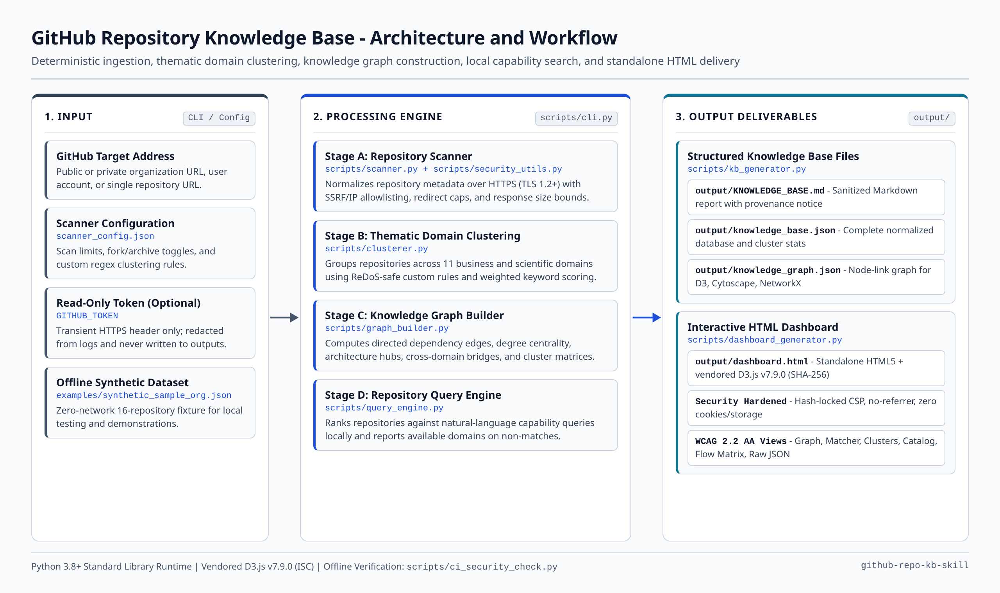

# GitHub Repository Knowledge Base Dashboard

An agent skill and Python engine that analyzes GitHub organizations, user profiles, or repository collections to generate a thematic domain knowledge base, an architectural knowledge graph, a standalone interactive HTML5 dashboard, and natural-language repository capability search.

---

## Table of Contents

- [Overview](#overview)
- [Architecture and Workflow](#architecture-and-workflow)
- [Project Structure and File Tree](#project-structure-and-file-tree)
- [Thematic Domain Clustering](#thematic-domain-clustering)
- [Non-Technical User Guide: How to Use This Skill](#non-technical-user-guide-how-to-use-this-skill)
  - [What This Skill Does in Plain Terms](#what-this-skill-does-in-plain-terms)
  - [Core Concepts Explained](#core-concepts-explained)
  - [Step-by-Step Instructions](#step-by-step-instructions)
  - [Scanning Private Organizations or Restricted Repositories with a Token (PAT)](#scanning-private-organizations-or-restricted-repositories-with-a-token-pat)
  - [Asking Questions and Searching for Programs in Chat](#asking-questions-and-searching-for-programs-in-chat)
  - [Real-World Usage Scenarios and Example Prompts](#real-world-usage-scenarios-and-example-prompts)
  - [How to Interact with the Interactive HTML Dashboard](#how-to-interact-with-the-interactive-html-dashboard)
  - [Troubleshooting Common Situations](#troubleshooting-common-situations)
- [Webview Integration and Architecture](#webview-integration-and-architecture)
- [Key Features](#key-features)
- [Requirements](#requirements)
- [Configuration Guide](#configuration-guide)
- [Running the Python Code Directly](#running-the-python-code-directly)
  - [1. Quick Start with Offline Synthetic Data](#1-quick-start-with-offline-synthetic-data)
  - [2. Scanning a Live Public GitHub Organization or User](#2-scanning-a-live-public-github-organization-or-user)
  - [3. Scanning Private Organizations and Restricted Repositories with a PAT](#3-scanning-private-organizations-and-restricted-repositories-with-a-pat)
  - [4. Querying the Knowledge Base via CLI](#4-querying-the-knowledge-base-via-cli)
  - [5. Scanning a Single Repository](#5-scanning-a-single-repository)
  - [6. CLI Reference](#6-cli-reference)
  - [7. Running Automated Tests and Verification Checks](#7-running-automated-tests-and-verification-checks)
- [Architecture and Data Model](#architecture-and-data-model)
  - [Thematic Domain Taxonomy](#thematic-domain-taxonomy)
  - [Knowledge Graph Schema](#knowledge-graph-schema)
  - [Centrality and Hub Classification](#centrality-and-hub-classification)
- [Interactive Dashboard Components](#interactive-dashboard-components)
- [Security, Accessibility, and Compliance](#security-accessibility-and-compliance)
- [License](#license)

---

## Overview

Software organizations frequently maintain dozens or hundreds of repositories spanning clinical health applications, genomics workflows, billing services, authentication systems, SDKs, and cloud infrastructure. Mapping domain boundaries and architectural dependencies across these codebases manually is time-consuming.

The `github-repo-kb` skill automates ingestion, classification, graph construction, and visualization:
1. Ingests repository metadata from live GitHub accounts (public organizations, private organizations, user profiles, single repositories) or offline synthetic datasets.
2. Classifies repositories into functional **thematic domain clusters** (such as Medical & Healthcare, Life Sciences & Bioinformatics, Finance & Billing, Security & Identity, AI/ML, Developer Tooling, Infrastructure, and Utilities) based on project purpose and subject matter rather than programming language alone.
3. Builds a directed architectural knowledge graph capturing intra-cluster and cross-cluster relationships (dependencies, integrations, client SDKs, shared infrastructure, and shared technologies).
4. Provides local repository search so users can ask questions in natural language and identify the best-suited repository for a given capability.
5. Generates structured documentation (`output/KNOWLEDGE_BASE.md`, `output/knowledge_base.json`, `output/knowledge_graph.json`) and a standalone interactive HTML dashboard (`output/dashboard.html`).

---

## Architecture and Workflow



The diagram above illustrates the end-to-end processing pipeline:
- **Input**: GitHub target address (public or private organization URL, user account, or single repository), configuration settings in `scanner_config.json`, GitHub Personal Access Token (PAT) via `GITHUB_TOKEN` for private access, or offline synthetic JSON datasets.
- **Processing Engine**:
  1. *Repository Scanner (`scripts/scanner.py`)*: Fetches and normalizes repository metadata, dependencies, topics, languages, and metrics over HTTPS (`TLS >= 1.2`) or from local fixtures.
  2. *Thematic Domain Clustering (`scripts/clusterer.py`)*: Evaluates custom regex rules, topics, languages, and descriptions to group repositories into functional domains.
  3. *Knowledge Graph Builder (`scripts/graph_builder.py`)*: Constructs directed relationships, computes centrality scores, and detects architectural hubs and cross-domain bridges.
  4. *Repository Query Engine (`scripts/query_engine.py`)*: Scores natural-language capability requests locally to recommend matching repositories or report when no repository satisfies the need.
- **Output Deliverables**:
  - *Structured Knowledge Base Files*: Machine-readable JSON specifications (`output/knowledge_base.json`, `output/knowledge_graph.json`) and a Markdown catalog (`output/KNOWLEDGE_BASE.md`).
  - *Interactive HTML Dashboard (`output/dashboard.html`)*: Self-contained HTML5/D3.js application with force-directed graph physics, thematic domain cards, local repository matcher, sortable catalog, flow matrix, and inspection drawer.

---

## Project Structure and File Tree

All project files are organized relative to the repository root directory:

```text
.
|-- .env.example                           # Environment variable template for GITHUB_TOKEN
|-- .gitignore                             # Git ignore rules for build, cache, and credential files
|-- DESIGN.md                              # Dashboard visual, architecture, theme, and accessibility specification
|-- LICENSE                                # Apache License 2.0 full text
|-- README.md                              # Project documentation and non-technical user guide
|-- SKILL.md                               # Agent skill definition, workflow, and untrusted-data guardrails
|-- THIRD_PARTY_LICENSES.md                # Third-party license attribution and vendored asset checksums
|-- prd.md                                 # Product Requirements Document reflecting design and implementation
|-- requirements.txt                       # Runtime requirements note (Python 3.8+ standard library)
|-- scanner_config.json                    # Default editable scanner and clustering configuration
|-- scanner_config.template.json           # Configuration template with placeholder values
|-- assets/
|   `-- workflow_overview.png              # End-to-end architecture and workflow diagram
|-- docs/
|   `-- legal/
|       |-- ACCESSIBILITY_STATEMENT.md     # WCAG 2.2 AA accessibility statement template
|       |-- COOKIE_AND_STORAGE_POLICY.md   # Zero-cookie and zero-storage disclosure template
|       |-- PRIVACY_POLICY.md              # Privacy policy template for operators
|       |-- ROPA_AND_GOVERNANCE.md         # Record of processing activities and governance template
|       `-- TERMS_OF_USE.md                # Terms of use template
|-- examples/
|   |-- synthetic_sample_org.json          # 16-repository multi-domain synthetic demonstration dataset
|   `-- sample_output/                     # Pre-generated sample artifacts from synthetic dataset
|       |-- KNOWLEDGE_BASE.md              # Pre-generated technical Markdown report
|       |-- dashboard.html                 # Pre-generated standalone HTML dashboard
|       |-- knowledge_base.json            # Pre-generated structured JSON knowledge base
|       `-- knowledge_graph.json           # Pre-generated node-link graph specification
|-- output/                                # Default output directory for pipeline runs
|   |-- KNOWLEDGE_BASE.md                  # Generated Markdown knowledge base catalog
|   |-- dashboard.html                     # Generated standalone HTML dashboard
|   |-- knowledge_base.json                # Generated JSON knowledge base
|   `-- knowledge_graph.json               # Generated node-link graph JSON
|-- scripts/
|   |-- __init__.py                        # Python package initialization
|   |-- ci_security_check.py               # Offline supply-chain, secret scan, and CSP verification gate
|   |-- cli.py                             # Command-line interface and pipeline orchestrator
|   |-- clusterer.py                       # Thematic domain classifier and custom regex rule engine
|   |-- dashboard_generator.py             # Standalone HTML dashboard generator with CSP hash locking
|   |-- graph_builder.py                   # Knowledge graph builder and centrality analyzer
|   |-- kb_generator.py                    # Markdown and JSON knowledge base generator
|   |-- query_engine.py                    # Natural-language repository capability matcher
|   |-- scanner.py                         # GitHub REST API ingestion engine and fixture loader
|   |-- security_utils.py                  # Shared path, URL, SSRF, ReDoS, and secret redaction utilities
|   `-- vendor/
|       |-- D3_LICENSE                     # ISC license text for vendored D3.js v7.9.0
|       `-- d3.v7.min.js                   # Vendored D3.js v7.9.0 minified bundle (SHA-256 verified)
`-- tests/
    |-- test_clusterer.py                  # Unit tests for thematic domain clustering and custom rules
    |-- test_dashboard.py                  # Unit tests for standalone HTML dashboard generation
    |-- test_e2e.py                        # End-to-end integration tests for the full pipeline
    |-- test_graph_builder.py              # Unit tests for nodes, edges, and centrality calculations
    |-- test_kb_generator.py               # Unit tests for Markdown and JSON artifact formatting
    |-- test_query_engine.py               # Unit tests for natural-language repository capability search
    |-- test_scanner.py                    # Unit tests for URL parsing and metadata normalization
    `-- test_security_and_a11y.py          # Verification tests for security hardening and WCAG 2.2 AA
```

---

## Thematic Domain Clustering

Rather than grouping repositories exclusively by programming language, the skill classifies repositories by their **thematic domain, functional purpose, and subject matter**:

- **Medical & Healthcare**: Clinical EHR/EMR records, patient portals, FHIR/HL7 interoperability, medical imaging (DICOM), HIPAA workflows, and telehealth systems.
- **Life Sciences & Bioinformatics**: Genomics sequencing, DNA/RNA variant calling pipelines, molecular biology assays, clinical trials, and biomarker datasets.
- **Finance, Billing & Commerce**: Invoicing, payment gateways, subscription billing, checkout workflows, and accounting ledgers.
- **Security, Identity & Access**: OAuth2 / OIDC authentication, identity management, JWT token signing, and role-based access control (RBAC).
- **Data Intelligence & AI/ML**: Machine learning models, LLM inference, embeddings pipelines, ETL streaming, and vector databases.
- **Developer Tooling & SDKs**: Official client libraries, command-line utilities (CLIs), code generators, and linters.
- **Infrastructure & Cloud Operations**: Terraform infrastructure-as-code, Kubernetes manifests, Helm charts, and CI/CD pipelines.
- **Core Platform & Business Services**: Central API gateways, user profiles, tenant management, and notification dispatchers.
- **User Applications & Web Portals**: Patient portals, administrative dashboards, customer consoles, and web applications.
- **Utilities & Shared Libraries**: Reusable protocol buffers, shared data contracts, and base utility helpers.
- **Documentation & Specifications**: System architecture specifications, OpenAPI blueprints, and technical RFCs.

---

## Non-Technical User Guide: How to Use This Skill

### What This Skill Does in Plain Terms

You do not need to write code or memorize terminal commands to use this tool.

When you give this skill a GitHub web address (for example, a public open-source organization such as `https://github.com/pallets`, an individual developer's profile, or a private organization accessed with a Personal Access Token), it inspects the repository catalog, groups projects into plain-English subject areas (such as Medical & Healthcare, Life Sciences, Billing, or Security), maps how those projects depend on each other, creates an interactive visual dashboard (`output/dashboard.html`), and lets you ask plain-language questions about which project handles a specific task.

---

### Core Concepts Explained

- **Repository (Repo)**: A single software project or codebase folder stored on GitHub.
- **Organization / Account**: A collection of repositories managed by a team, open-source community, or individual.
- **Personal Access Token (PAT)**: A digital access key created in your GitHub account settings that grants read permission to private organizations or restricted repositories.
- **Thematic Domain Cluster**: A subject-matter group of related projects. For example, clinical record systems are grouped under "Medical & Healthcare", DNA sequencing under "Life Sciences & Bioinformatics", and invoicing under "Finance, Billing & Commerce".
- **Knowledge Graph**: An interactive map where each circle represents a software repository and each connecting line shows how projects depend on one another or share technologies.
- **Repository Matcher & Search**: A search tool that tells you which repository best fits a plain-language request, or states clearly when no repository in the organization covers that capability.
- **Interactive HTML Dashboard**: A self-contained web page (`output/dashboard.html`) that opens directly in your web browser or inside an AI assistant's embedded preview pane.

---

### Step-by-Step Instructions

#### Step 1: Open Your AI Assistant or Terminal
Open any AI assistant workspace configured with this skill (or open a terminal window in the project root directory).

#### Step 2: Request an Analysis
Type a plain-English request specifying the GitHub address you want to inspect. For example:
> "Please scan https://github.com/pallets using the github-repo-kb skill and open the interactive dashboard."

#### Step 3: Review the Summary and Dashboard
The skill will:
1. Scan and group the repositories into thematic domains.
2. Summarize the portfolio size, domain categories, and central hub repositories.
3. Generate `output/dashboard.html` so you can explore the architecture interactively.

#### Step 4: Ask Questions or Search Visually
Ask follow-up questions in chat (for example, *"Which repository should I use for patient electronic health records?"*) or open the **Repository Matcher & Chat** tab inside the dashboard to search without typing commands.

---

### Scanning Private Organizations or Restricted Repositories with a Token (PAT)

If the GitHub address belongs to a private organization or restricted account, you need a read-only **Personal Access Token (PAT)** so the scanner can authenticate:

#### 1. Creating a Least-Privilege GitHub Token
1. In GitHub, open your account menu in the top-right corner and select **Settings**.
2. In the left sidebar, open **Developer settings**.
3. Select **Personal access tokens** and choose **Fine-grained tokens** (recommended for least-privilege access) or **Tokens (classic)** if required by your organization policy.
4. Click **Generate new token**, restrict access to the target organization or repositories, and grant minimal read-only permissions:
   - **Fine-grained PAT (Recommended)**: **Repository permissions -> Metadata: Read-only**.
   - **Classic PAT (Legacy fallback)**: `public_repo` for public rate-limit expansion, or `repo` + `read:org` only when scanning private organization repositories.
5. If your organization enforces **SAML Single Sign-On (SSO)**:
   - Click **Configure SSO** next to the token on GitHub and click **Authorize** for your organization.
6. Copy the token and store it securely; never commit a real token into source control.

#### 2. Supplying the Token

You can provide the token using one of the following methods:

- **Method A: Environment Variable (Recommended)**
  ```bash
  export GITHUB_TOKEN="<YOUR_GITHUB_TOKEN>"
  ```
  Then request the scan in chat:
  > "Please analyze our private organization https://github.com/your-org using the GITHUB_TOKEN environment variable."

- **Method B: Local Uncommitted Configuration File (`scanner_config.local.json`)**
  > **Security Warning:** Do not place real tokens in tracked `scanner_config.json`. Keep `"auth_token": ""` in tracked files and use `GITHUB_TOKEN`, or store credentials in the gitignored `scanner_config.local.json`.
  ```json
  {
    "target_url": "https://github.com/your-org",
    "auth_token": "<YOUR_GITHUB_TOKEN>"
  }
  ```

- **Method C: Command-Line Flag (Legacy; Emits Security Warning)**
  > **Security Warning:** Passing `--token` on the command line exposes the token in shell history and process listings (`ps`). The CLI accepts `--token` for backward compatibility but logs a warning to `stderr`; prefer `GITHUB_TOKEN`.
  ```bash
  python3 scripts/cli.py --url https://github.com/your-org --token "<YOUR_GITHUB_TOKEN>"
  ```

*Security Note: The token is sent exclusively in HTTPS (`TLS >= 1.2`) headers to `https://api.github.com`. Tokens are automatically redacted from error logs and are never written to JSON, Markdown, or HTML output files.*

---

### Asking Questions and Searching for Programs in Chat

Once an organization is analyzed, you can ask about any capability or program. The skill returns the highest-scoring repository with its reasoning, or explains that no repository covers the request.

#### Example 1: Finding a Clinical Records Service
- **Question**: *"Which repository handles patient electronic health records and FHIR integration?"*
- **Response**:
  > **Best Matched Repository**: `sample-patient-records` (High Confidence)
  >
  > **Domain**: Medical & Healthcare | **Language**: Go
  >
  > **GitHub URL**: `https://github.com/sample-platform/sample-patient-records`
  >
  > **Why this fits**: The repository provides clinical electronic health record (EHR) storage conforming to HL7 FHIR R4 standards.

#### Example 2: Finding a Genomics Workflow
- **Question**: *"Where is DNA sequencing and bioinformatics variant analysis processed?"*
- **Response**:
  > **Best Matched Repository**: `sample-genomics-pipeline` (High Confidence)
  >
  > **Domain**: Life Sciences & Bioinformatics | **Language**: Python
  >
  > **Why this fits**: This repository implements distributed bioinformatics pipelines for DNA/RNA sequencing and variant analysis.

#### Example 3: Asking About a Capability Not Present in the Organization
- **Question**: *"Is there a repository for video transcoding and media streaming?"*
- **Response**:
  > **No matching repository found**: No repository in this organization can answer your need for *"video transcoding and media streaming"*.
  >
  > The organization currently contains repositories across these domains: *Medical & Healthcare*, *Life Sciences & Bioinformatics*, *Finance, Billing & Commerce*, *Security, Identity & Access*, *Data Intelligence & AI/ML*, *Developer Tooling & SDKs*, *Infrastructure & Cloud Operations*, *Core Platform & Business Services*, *Utilities & Shared Libraries*, and *Documentation & Specifications*.

---

### Real-World Usage Scenarios and Example Prompts

#### Scenario 1: Reviewing a Public Open-Source Organization
```text
Please run the github-repo-kb skill on https://github.com/pallets. Group all projects into thematic domains, build the architecture knowledge graph, and open output/dashboard.html.
```

#### Scenario 2: Auditing a Private Organization Using `GITHUB_TOKEN`
```text
Please run the github-repo-kb skill on https://github.com/my-private-org using GITHUB_TOKEN, classify internal services into thematic domains, and generate the interactive dashboard and Markdown catalog.
```

#### Scenario 3: Running an Offline Demonstration Without Network Access
```text
Run the github-repo-kb skill using the offline synthetic sample dataset in examples/synthetic_sample_org.json and display the resulting dashboard.
```

#### Scenario 4: Editing `scanner_config.json` for Repeat Scans
1. Open `scanner_config.json` in any text editor.
2. Update `"target_url"` to your target organization (for example, `"https://github.com/your-organization"`).
3. Save the file and export `GITHUB_TOKEN` if the organization is private.
4. Ask your assistant:
```text
Please run the github-repo-kb skill using the settings in scanner_config.json.
```

---

### How to Interact with the Interactive HTML Dashboard

When `output/dashboard.html` opens in your web browser or assistant preview pane:

1. **Repository Matcher & Chat Tab**:
   - Select the **Repository Matcher & Chat** tab.
   - Enter a plain-language requirement (for example, *"FHIR patient records"*, *"DNA sequencing"*, or *"OAuth2 authentication"*) or click one of the suggestion buttons.
   - Review the ranked match card and click **Locate on Knowledge Graph** to jump directly to that repository node.
2. **Header Scan Bar and Preset Switcher**:
   - Paste a public GitHub URL into the header input field and click **Scan Address** to fetch and re-cluster that public target directly in the browser.
   - Use the preset dropdown to switch between the current scanned dataset, the synthetic 16-repository demo, `pallets`, or `fastapi`.
3. **Knowledge Graph Viewport**:
   - **Zoom and Pan**: Scroll to zoom or click `+`, `-`, and `Fit` in the zoom bar. Click and drag the background to pan.
   - **Auto-Framing**: The graph automatically frames all domain clusters on load and reset.
   - **Cluster Focus**: Choose a domain from the **All Clusters** dropdown to isolate and center on that domain.
   - **Node Inspection**: Click any circle (or focus it with `Tab` and press `Enter` or `Space`) to open its details in the side drawer.
   - **Physics Toggle**: Click **Pause Physics** to freeze node positions.
4. **Inspection Side Drawer**:
   - Displays the selected repository's description, star count, primary language, tech stack, topics, incoming consumers, and outgoing dependencies. Clicking any connected repository focuses that node.
5. **Cluster Explorer, Repository Catalog, and Cross-Domain Flow**:
   - Browse expandable thematic domain cards, sort and filter the tabular repository catalog, or inspect inter-cluster dependency counts in the Cross-Domain Flow matrix.

---

### Troubleshooting Common Situations

- **GitHub Rate Limit Warning**:
  - Unauthenticated GitHub API requests are limited to 60 requests per hour per IP address.
  - Exporting a Personal Access Token in `GITHUB_TOKEN` raises the limit to 5,000 requests per hour.
  - To test without hitting the API, run offline mode with `examples/synthetic_sample_org.json`.
- **Private Organization Returning HTTP 404 or 403**:
  - GitHub returns HTTP 404 for private organizations when authentication is missing or lacks permission.
  - Verify your Fine-grained PAT includes **Repository permissions -> Metadata: Read-only** (or Classic PAT `repo` and `read:org` scopes).
  - If your organization requires SAML SSO, open the token settings on GitHub and click **Configure SSO -> Authorize** for that organization.
- **Opening the Dashboard Directly on Your Computer**:
  - `output/dashboard.html` is a standalone HTML file. Double-click it or open it in any standard web browser without needing an internet connection or local web server.

---

## Webview Integration and Architecture

`output/dashboard.html` is structured for direct rendering inside standard web browsers and sandboxed agent webviews or iframes:
- **Zero Build Step or Backend Server**: Pure HTML5, CSS custom properties, vanilla JavaScript, and inline vendored D3.js v7.9.0.
- **Offline-First Operation**: Loads with zero outbound network requests, zero external CDN dependencies, zero cookies, and zero browser storage writes.
- **Client-Side Live Scanner**: Includes a hardened public GitHub URL scanner (`api.github.com` only, `credentials: 'omit'`, `referrerPolicy: 'no-referrer'`).
- **Responsive Layout**: Reflows cleanly across desktop viewports, narrow side panes, and `320px` mobile widths.

---

## Key Features

- **Standard Library Python Implementation**: Runs on Python 3.8+ with zero mandatory third-party Python dependencies.
- **Thematic Domain Taxonomy**: Groups codebases by business and scientific domain (Medical, Life Sciences, Finance, Security, AI/ML, Tooling, Infrastructure, Core Platform, Applications, Utilities, and Documentation).
- **Public, Private, and Offline Ingestion**: Supports public GitHub accounts, token-authenticated private organizations, single repositories, and offline synthetic JSON fixtures.
- **Client-Side Public Scanner**: Fetch and re-cluster public GitHub targets directly inside `output/dashboard.html`.
- **Natural-Language Repository Matcher**: Evaluates capability queries via CLI (`--query`) or dashboard UI with explicit non-match reporting.
- **Architectural Knowledge Graph**: Generates directed dependency relationships, degree centrality scores, hub/bridge flags, and inter-cluster flow matrices.
- **Multi-Cluster Auto-Framing and Semantic Zoom**: Keeps all clusters framed on load and reset, with configurable label visibility (`smart`, `all`, `hubs`) and spacing (`balanced`, `wide`, `compact`).
- **Inspection Side Drawer**: Displays repository metadata, tech stack, topics, and navigable incoming/outgoing connections.
- **Security Hardening and WCAG 2.2 AA Accessibility**: Enforces SHA-256 verified vendored D3.js, hash-locked CSP, SSRF/path/ReDoS defenses, keyboard navigation, and verified Dark/Light contrast ratios.
- **Automated Verification Suite**: Includes synthetic non-PHI fixtures, 48 automated unit/integration/security/accessibility tests, and an offline CI security gate.

---

## Requirements

- Python 3.8 or higher.
- Python standard library modules (`urllib`, `json`, `re`, `argparse`, `math`, `collections`, `os`, `sys`, `hashlib`, `base64`, `ssl`, `socket`, `ipaddress`, `unittest`).
- Optional: `pytest` (MIT License) if preferred over built-in `unittest`.

---

## Configuration Guide

Edit `scanner_config.json` (or copy `scanner_config.template.json`) to configure targets, scan options, and custom thematic clustering rules:

```json
{
  "target_url": "https://github.com/pallets",
  "auth_token": "",
  "scan_options": {
    "include_forks": false,
    "include_archived": true,
    "max_repos": 100,
    "offline_fixture": ""
  },
  "clustering_rules": [
    {
      "pattern": ".*-patient|.*-ehr|.*-telehealth|.*-medical|.*-clinical",
      "cluster_id": "medical-healthcare"
    },
    {
      "pattern": ".*-genomics|.*-bio.*|.*-trials|.*-dna",
      "cluster_id": "life-sciences-bio"
    },
    {
      "pattern": ".*-billing|.*-payment|.*-invoice|.*-checkout",
      "cluster_id": "finance-billing"
    },
    {
      "pattern": ".*-auth|.*-identity|.*-security|.*-sso",
      "cluster_id": "security-identity"
    },
    {
      "pattern": ".*-ai-.*|.*-pipeline|.*-analytics|.*-data",
      "cluster_id": "data-ai-analytics"
    },
    {
      "pattern": ".*-sdk|.*-client|.*-cli",
      "cluster_id": "developer-tooling"
    },
    {
      "pattern": ".*-infra|.*-infrastructure|.*-cloud",
      "cluster_id": "infrastructure-devops"
    },
    {
      "pattern": ".*-gateway|.*-user-service|.*-notification",
      "cluster_id": "core-platform"
    },
    {
      "pattern": ".*-common|.*-utils|.*-core-lib",
      "cluster_id": "utilities-libraries"
    },
    {
      "pattern": ".*-docs|.*-specs|.*-architecture",
      "cluster_id": "documentation-specs"
    }
  ],
  "output": {
    "output_dir": "output",
    "generate_dashboard": true,
    "generate_markdown": true,
    "generate_json": true
  }
}
```

---

## Running the Python Code Directly

### 1. Quick Start with Offline Synthetic Data

```bash
# Run using the built-in synthetic fixture
python3 scripts/cli.py --fixture examples/synthetic_sample_org.json --output-dir output/

# Or run using scanner_config.json
python3 scripts/cli.py --config scanner_config.json
```

### 2. Scanning a Live Public GitHub Organization or User

```bash
python3 scripts/cli.py --url https://github.com/pallets
```

### 3. Scanning Private Organizations and Restricted Repositories with a PAT

Set a Fine-grained Personal Access Token (Metadata: Read-only) via environment variable:

```bash
# Option A: Environment variable (Recommended)
export GITHUB_TOKEN="<YOUR_GITHUB_TOKEN>"
python3 scripts/cli.py --url https://github.com/your-private-org

# Option B: Legacy CLI argument (emits security warning to stderr)
python3 scripts/cli.py --url https://github.com/your-private-org --token "<YOUR_GITHUB_TOKEN>"

# Option C: Local uncommitted config (scanner_config.local.json)
python3 scripts/cli.py --config scanner_config.local.json
```

### 4. Querying the Knowledge Base via CLI

```bash
# Query for clinical patient records
python3 scripts/cli.py --query "Patient electronic health records and FHIR"

# Query for DNA genomics pipelines
python3 scripts/cli.py --query "Bioinformatics DNA variant analysis"

# Query for a non-matching capability
python3 scripts/cli.py --query "Blockchain cryptocurrency mining smart contract"
```

### 5. Scanning a Single Repository

```bash
# Public single repository
python3 scripts/cli.py --url https://github.com/pallets/flask

# Private single repository using GITHUB_TOKEN
export GITHUB_TOKEN="<YOUR_GITHUB_TOKEN>"
python3 scripts/cli.py --url https://github.com/your-private-org/private-service
```

### 6. CLI Reference

```text
usage: cli.py [-h] [--url URL] [--config CONFIG] [--fixture FIXTURE]
              [--output-dir OUTPUT_DIR] [--token TOKEN] [--max-repos MAX_REPOS]
              [--include-forks] [--query QUERY] [--kb KB] [--verbose]

Options:
  -h, --help            Show help message and exit
  --url URL, -u URL     GitHub URL or owner handle (e.g. 'https://github.com/pallets')
  --config CONFIG, -c CONFIG
                        Path to configuration JSON file (default: scanner_config.json)
  --fixture FIXTURE, -f FIXTURE
                        Path to offline synthetic dataset JSON
  --output-dir OUTPUT_DIR, -o OUTPUT_DIR
                        Directory to save generated artifacts (default: output/)
  --token TOKEN, -t TOKEN
                        GitHub Personal Access Token (or GITHUB_TOKEN env variable)
  --max-repos MAX_REPOS Maximum repositories to scan (default: 100)
  --include-forks       Include forked repositories in scan
  --query QUERY, -q QUERY
                        Ask about a software need or program to find the best suited repository
  --kb KB               Path to knowledge_base.json for query resolution
  --verbose, -v         Enable verbose logging
```

### 7. Running Automated Tests and Verification Checks

Run the complete test suite with Python's built-in `unittest`:

```bash
python3 -m unittest discover -s tests -v
```

Run the offline supply-chain, secret-scanning, and CSP verification gate:

```bash
python3 scripts/ci_security_check.py
```

The 48 unit, integration, security, and accessibility tests verify URL parsing, SSRF protection, path confinement, ReDoS rejection, metadata normalization, thematic clustering, graph centrality, capability search, Markdown/JSON sanitization, CSP hash integrity, vendored D3.js checksum verification, and WCAG 2.2 AA dashboard requirements.

---

## Architecture and Data Model

### Thematic Domain Taxonomy

| Domain ID | Thematic Domain Name | Typical Subjects / Keywords |
|---|---|---|
| `medical-healthcare` | Medical & Healthcare | EHR, EMR, FHIR, HL7, DICOM, clinical notes, patient care, telehealth, HIPAA |
| `life-sciences-bio` | Life Sciences & Bioinformatics | Genomics, DNA, RNA, sequencing, bioinformatics, clinical trials, biomarker assays |
| `finance-billing` | Finance, Billing & Commerce | Subscription billing, invoicing, checkout, payment gateways, accounting ledgers |
| `security-identity` | Security, Identity & Access | OAuth2, OIDC, JWT, RBAC, IAM, authentication, encryption, secrets management |
| `data-ai-analytics` | Data Intelligence & AI/ML | Machine learning, LLMs, embeddings, RAG, Kafka streaming, Flink, ETL, ClickHouse |
| `developer-tooling` | Developer Tooling & SDKs | Python SDK, TypeScript SDK, CLI utilities, code generators, testing harnesses |
| `infrastructure-devops` | Infrastructure & Cloud Operations | Terraform, Kubernetes, Helm, Docker, CI/CD pipelines, cloud monitoring |
| `core-platform` | Core Platform & Business Services | API gateway, reverse proxy, user tenancy, notification dispatchers |
| `frontend-applications` | User Applications & Web Portals | Patient portals, physician dashboards, customer consoles, web interfaces |
| `utilities-libraries` | Utilities & Shared Libraries | Protocol buffers, shared data contracts, base utility helpers, schemas |
| `documentation-specs` | Documentation & Specifications | Architectural blueprints, OpenAPI specs, technical guides, RFC standards |

---

### Knowledge Graph Schema

#### Node Properties

```json
{
  "id": 103,
  "name": "sample-patient-records",
  "full_name": "sample-platform/sample-patient-records",
  "html_url": "https://github.com/sample-platform/sample-patient-records",
  "description": "Electronic health record (EHR/EMR) service with HL7 FHIR interoperability, clinical notes, and HIPAA compliant patient store.",
  "primary_language": "Go",
  "topics": ["medical", "healthcare", "clinical", "patient", "ehr", "fhir", "hipaa", "records"],
  "tech_stack": ["Go", "PostgreSQL", "FHIR", "Docker"],
  "stars": 340,
  "forks": 42,
  "open_issues": 6,
  "cluster_id": "medical-healthcare",
  "cluster_name": "Medical & Healthcare",
  "cluster_color": "#0EA5E9",
  "in_degree": 3,
  "out_degree": 2,
  "total_degree": 5,
  "centrality_score": 0.333,
  "is_hub": true,
  "is_bridge": true
}
```

#### Edge Properties

```json
{
  "source": 104,
  "target": 103,
  "type": "depends_on",
  "label": "Consumes Clinical API",
  "description": "sample-telehealth-portal imports and depends on sample-patient-records.",
  "weight": 2.5,
  "is_cross_cluster": false,
  "source_cluster": "medical-healthcare",
  "target_cluster": "medical-healthcare"
}
```

---

### Centrality and Hub Classification

- **Degree Centrality**: Calculated as `total_connections / (total_repositories - 1)`.
- **Architecture Hubs (`is_hub`)**: Repositories upon which multiple other repositories depend (`total_degree >= 4`, or `centrality_score >= 0.35` with `total_degree >= 2`).
- **Cross-Domain Bridges (`is_bridge`)**: Repositories connected to two or more distinct thematic clusters.

---

## Interactive Dashboard Components

The generated standalone dashboard (`output/dashboard.html`) includes the following interactive controls (see [DESIGN.md](DESIGN.md) for visual tokens and layout specifications):

1. **Top Action & Ingestion Bar**:
   - Live public GitHub URL input and `Scan Address` button.
   - Dataset preset selector (`current`, `synthetic`, `pallets`, `fastapi`).
   - Dark / Light theme button (`Theme`).
   - `Export JSON` and `Print View` buttons.
2. **Metric Summary Cards**:
   - Live counts for Total Repositories, Thematic Clusters, Graph Relationships, Cross-Cluster Edges, Aggregate Stars, and Architecture Hubs.
3. **Knowledge Graph Viewport (Vendored D3.js v7.9.0)**:
   - Zoom, pan, node dragging, cluster region hulls, and zoom bar (`+`, `%`, `-`, `Fit`).
   - Color-coded thematic nodes with hub highlight rings and dashed cross-cluster edges.
   - Live search input, cluster filter, relationship filter, label visibility selector, spacing selector, Reset View, and Pause Physics toggle.
4. **Inspection Side Drawer**:
   - Shows repository metadata, tech stack, topics, external GitHub link, incoming consumers, and outgoing dependencies with clickable node focus navigation.
5. **Repository Matcher & Chat Tab**:
   - Local capability search input, suggestion query buttons, confidence scoring, rationale list, and **Locate on Knowledge Graph** action.
6. **Cluster Explorer Tab**:
   - Expandable cards for each thematic domain with selectable repository rosters.
7. **Repository Catalog Tab**:
   - Searchable, filterable, sortable table with per-row `Inspect` buttons.
8. **Cross-Domain Flow Matrix and Raw JSON & Config Tabs**:
   - Interactive inter-cluster connectivity matrix and read-only JSON viewer with clipboard copy button.

---

## Security, Accessibility, and Compliance

- **No PHI/PII**: Sample datasets in `examples/` and test suites use synthetic, fictional repository names and descriptions. This tool is not designed or certified to store or process Protected Health Information (PHI) or Personally Identifiable Information (PII).
- **Token Protection & Sanitization**: Use `GITHUB_TOKEN` with a Fine-grained Personal Access Token (Metadata: Read-only). Tokens are redacted from error logs, transmitted only over HTTPS (`TLS >= 1.2`) to `https://api.github.com`, and never persisted to output files.
- **Offline-First & Hardened Dashboard**: D3.js v7.9.0 is vendored locally with SHA-256 verification. Generated `dashboard.html` enforces a hash-locked Content Security Policy (`script-src 'sha256-...'`), `Referrer-Policy: no-referrer`, zero cookies or browser storage, and zero outbound requests on load.
- **WCAG 2.2 AA Accessibility**: Full keyboard navigation (skip link, ARIA tablist, focusable graph nodes, semantic buttons and tables), verified Dark and Light contrast ratios, `prefers-reduced-motion` support, and `320px` responsive reflow.
- **Project Documentation & Governance**:
  - [prd.md](prd.md) - Product Requirements Document covering architecture, functional scope, security, and verification gates
  - [DESIGN.md](DESIGN.md) - Dashboard visual tokens, layout rules, theme definitions, and accessibility specification
  - [THIRD_PARTY_LICENSES.md](THIRD_PARTY_LICENSES.md) - Vendored dependency license attribution and SHA-256 checksums
  - [docs/legal/](docs/legal/) - Privacy Policy, Terms of Use, Cookie/Storage Policy, ROPA/Governance, and Accessibility Statement templates (require operator legal review before public hosting)

---

## License

This project is licensed under the Apache License, Version 2.0. See [LICENSE](LICENSE) for full license terms and [THIRD_PARTY_LICENSES.md](THIRD_PARTY_LICENSES.md) for third-party attributions.
